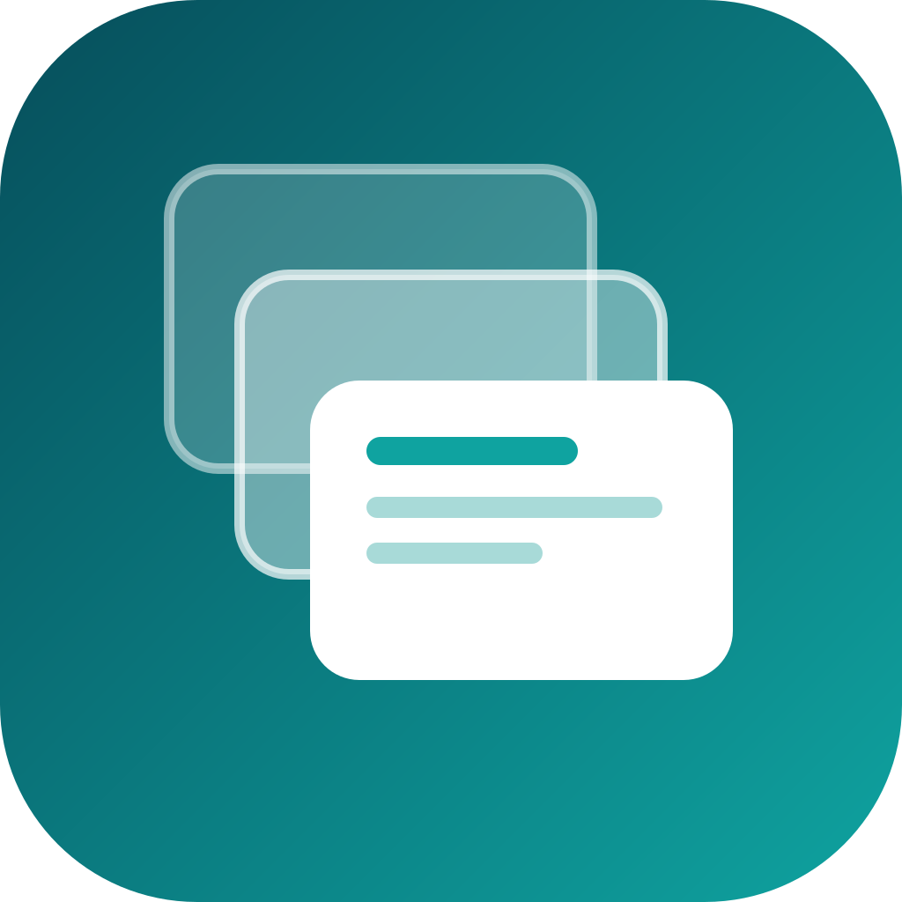

# DNZ-Scenes

**One hotkey, three screens, one profile.** DNZ-Scenes is a macOS menu bar app that switches your whole multi-monitor setup between named profiles (work, learning, leisure...). Each profile pins apps to screens, switches the wallpaper and has its own shortcut.

> Early-stage personal project (v0.4.0). Built for a 2 monitors + MacBook desk; developed on macOS 27, requires macOS 13+.



## Features
- **Profiles**: up to 20 named profiles with a colour and a wallpaper each; add, rename and delete them in the built-in editor.
- **Pin apps to screens**: assign apps to the left, right or laptop display; windows are tiled when you switch. Capture the current layout with one click.
- **One-key switching**: `ctrl+opt+1..9`, next/previous with `ctrl+opt+Right/Left`.
- **Profile ring**: `ctrl+opt+Space` opens a radial picker at the mouse pointer; click a profile to switch (like the Logi Actions Ring).
- **Logitech MX friendly**: bind any MX button to those shortcuts in Logi Options+; see below.
- **URL scheme**: `open dnzscenes://next`, `dnzscenes://switch/003`, `dnzscenes://ring` for Shortcuts and scripts.
- **No cloud**: no network, no telemetry, no dependencies. Config is a local JSON file (mode 600).

It does **not** use native macOS Spaces (there is no public API). The app manages its own virtual workspaces with the Accessibility API; no SIP changes, no private APIs.

## Install (build from source)
Requires Xcode or the Swift toolchain.
```bash
git clone https://github.com/<your-user>/DNZ-Scenes.git
cd DNZ-Scenes
./scripts/build-app.sh
open build/DNZ-Scenes.app
```
Quit a running copy first (menu > Quit); `open` on a running app only brings it to the front.

Run the logic checks (no Xcode test target needed): `swift run ScenesCoreChecks`.

## Permissions
Only **Accessibility** (System Settings > Privacy & Security > Accessibility) is needed, to move and resize windows.
Screen Recording, Input Monitoring and Automation are *not* required; deny them if macOS ever asks.
Ad-hoc signed builds change identity on every rebuild, so macOS may ask again. For a stable identity:
`SIGN_ID="Apple Development: Your Name (TEAMID)" ./scripts/build-app.sh`.

## Usage
1. Arrange your windows for a profile, then menu bar > **Capture Current Layout Into** > that profile. Or use **Add <frontmost app> To** for one app.
2. Switch from the menu, with a hotkey, or with the profile ring.
3. **Edit Profiles...** opens the editor: name, colour, wallpaper, apps (multi-select), add/delete profiles.
4. Plugged in different monitors? Use **Map Displays to Current Screens**.

Config: `~/Library/Application Support/DNZ-Scenes/config.json`. Hotkeys and ids are edited in that file for now.

### Wallpapers
The repository ships no wallpapers. Choose an image per profile in the editor (it is copied to `~/Library/Application Support/DNZ-Scenes/wallpapers/`), or drop files named like the profile's wallpaper entry (for example `001.png`) into that folder. Optional: put images in `assets/wallpapers/` before building to bundle them (that folder is git-ignored).

### Logitech MX (Logi Options+)
Hotkeys are ordinary global shortcuts, so any MX button or key that Logi Options+ can map to a **Keystroke** works:

| Action | Hotkey |
|---|---|
| Profile 1-9 | `ctrl+opt+1` ... `ctrl+opt+9` |
| Next / previous profile | `ctrl+opt+Right` / `ctrl+opt+Left` |
| Profile ring | `ctrl+opt+Space` |

Ideas: gesture button right/left = next/previous, thumb button = ring, Actions Ring slots = direct profile jumps.

## Known limits
- App-level, not window-level: every standard window of an assigned app gets the same frame; several apps on one screen are split side by side.
- Native full-screen apps live in their own Space and are not handled.
- Wallpaper change on multi-Space setups and window placement on real 3-screen hardware are only lightly tested.
- Not sandboxed (the Accessibility API is not supported in sandboxed apps), so not suitable for the Mac App Store.

## Project layout
`Sources/ScenesCore` pure logic (models, codec, switch plan, hotkey parsing) - `Sources/DNZScenes` menu bar app - `Sources/ScenesCoreChecks` dependency-free test runner - `docs/` ADR, security review and the project site - `scripts/build-app.sh` app bundle builder.

## About this project
Architecture decision: `docs/adr/ADR-0001-initial-architecture.md`. Security notes: [SECURITY.md](SECURITY.md).

## License
[MIT](LICENSE)
